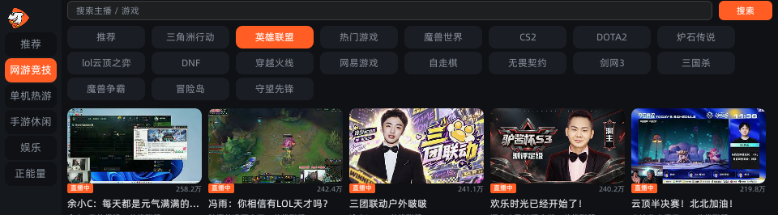
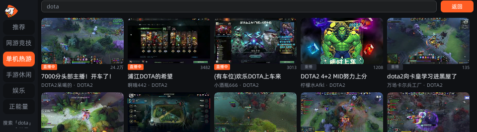
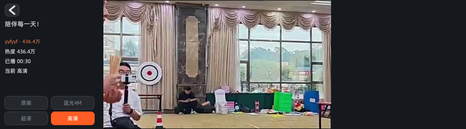

# PenDouyu

把斗鱼直播装进有道词典笔。

纯斗鱼直播客户端：推荐流 / 分类浏览 / 搜索 / 多码率切换 / 硬解直出。用有道自家的 Falcon 小程序框架（QuickJS + Vue 2 单文件组件）写成，屏幕只有 960×266 点，指甲盖大小。

当前版本 `2.1.0`，只支持 **X6 Pro**（RK3562 / aarch64）。


> **v2.1.0 修掉了一个隐蔽的取流 bug**：斗鱼 `/lapi/live/getH5PlayV1` 必须用 POST 请求。
> 之前一直用 GET，240 间房实测只有 **42 间（17.5%）**能取到流，其余全部返回
> `error:-15 非法请求` —— 而这个码与「房间不存在」长得一模一样，所以主页上约 83% 的
> 房间被误判成「未开播」。改成 POST 后 240/240 全部成功，连带还发现服务端其实能区分
> `-3 房间不存在` / `-4 封禁` / `-5 未开播`（GET 时代全被糊成 -15）。详见「技术实现 · 取流为什么必须 POST」。

> **v2.0.0 是一次减法**：1.0.0 是把斗鱼叠加在 [PenBili](https://github.com/56dz/PenBili)（B 站客户端）之上，一个 App 里塞两个站。2.0.0 把 B 站整套代码删干净了 —— 界面里的站点切换、推荐/热门/搜索 tabs、DASH 点播、评论区、图文详情、扫码登录、自检页全部移除，`src/services/bili/` 整目录、`feed.js`、`history.js`、`imgurl.js` 不再存在。换来的是把整个应用从 4248 行压到 1448 行、从三个 native 模块压到两个。

---

## 为什么值得做

这个项目从 [PenBili](https://github.com/56dz/PenBili) fork 出来。B 站那套点播链路（DASH 分离流 → ffmpeg → FIFO → Matroska → MPP 硬解）在 PenBili 里已经跑通，所以一开始我以为「把 URL 换成斗鱼的就完事了」。

结果斗鱼直播比 B 站点播难得多，因为**它不是 seek 的问题，是拉流的问题**：

- 斗鱼直播是单条 FLV（音视频交织），不需要拼两路 DASH，理论上更简单；
- 但斗鱼 CDN **不返回 `Content-Length`、不带 `Accept-Ranges`**，设备上的 `souphttpsrc` 在 seekable 判定处直接硬失败：`Server does not support seeking. Server does not accept Range HTTP header`，随后永久停在 PREROLLING；
- 改成 `is-live=true` / `iradio-mode=true` 换来的不是能播，而是 `403 Forbidden`；
- 设备上的 `ffmpeg` **任何命令都会挂死**（`rc=124`、日志 0 行、产物不存在），连 `-f lavfi -i testsrc` 这种纯本地源都跑不起来 —— 所以 PenBili 那条「ffmpeg 转封装」的路子在直播上完全走不通。

最后逼出来的方案是 **native 侧 fork 一个 `curl` 子进程，把字节写进命名管道，GStreamer 用 `filesrc` 读这条管道**。中间还发现这个固件上 **`curl` 的 stdout 管道是坏的**（`curl URL | cat` 得 0 字节，而 `curl URL -o file` 正常），所以必须 `-o <fifo>`，不能靠 shell 重定向，也不能 `fdsrc fd=0`。

这些结论没有一条是看文档能想到的，全是真机上一条一条撞出来的。

---

## 截图

全部为 X6 Pro 真机采集，960×266。

> 这一组图是 **v2.1.0 真机重拍**的（左栏顶部已经没有站点切换格，只剩纯斗鱼）。

**斗鱼推荐流** —— 左栏一级分类，内容区 5 列网格


**斗鱼二级分类** —— 顶部横排 chip：英雄联盟 / 热门游戏 / 三角洲行动 / DOTA2 / CS2 / 魔兽世界 / 炉石传说 / DNF / 无畏契约 …



**斗鱼搜索** —— 顶部一条 26px 紧凑搜索行，搜「dota」后按标题过滤出正在播的房间，底部「返回分类浏览」

> 搜索结果的裁行规则与浏览列表不同：浏览列表会裁掉不满一行的尾巴（避免露出半行残缺卡片），
> 但搜索结果**不足一行时原样显示**。斗鱼的标题直接命中很少（搜 `lol` 全站常常只命中 1 间），
> 照搬浏览规则会把唯一结果裁成 0，界面显示「没有搜到」而实际有结果 —— 这是 v2.1.0 修掉的 bug。



**斗鱼播放页** —— 左列房间信息 + 四档码率，中列硬件平面直出画面



> 除播放页外，其余截图都是 `miniapp_cli capture` 原样抓的 Falcon 画布层。视频走 DRM/KMS
> 硬件平面直出，不在画布里，所以画布截图里视频区是黑的——不是 bug。播放页那张是用
> `kmssrc` 单独抓了硬件平面帧，再按 `/sys/kernel/debug/dri/0/summary` 里 `Esmart1-win0`
> 的 dst 矩形逆变换贴回画布的（工具见 `tools/compose_shot.py`）。
>
> 抓截图前必须先 `hal-screen on && hal-screen set 60`。背光没开时抓出来是一张 2295 字节的
> 纯白图，很容易误判成「渲染失败」。

---

## 功能

**浏览**

- 一级分类 5 组 + 推荐：网游竞技 / 单机热游 / 手游休闲 / 娱乐 / 正能量，来自 `getLeftNav`
- 二级分类横排 chip（最多 18 个），选中后拉该分区房间，5 列网格、按整行裁剪不留半行
- 卡片：封面 166×93 + 下方一条 12px 角标 + 热度 + 标题 + 主播
  - 角标两种：橙色「直播中」= 此刻有实时信号；灰色「重播」= 录像轮播
  - 重播判据用列表接口自带的 `rst === 3`，**零额外请求**（120 间全量交叉验证
    TP=9 FP=0 FN=0 TN=111；真值取 `getRoomLoopInfo` 的 `loopType>0 && vid!==''`）
- 列表可无限下拉（每页 120 条），底部留「刷新 / 加载更多」两格

**播放**

- 签名取 FLV 直链 → native fork `curl` 拉流 → `flvdemux` → MPP 硬解 → KMS 平面直出
- 四档码率：原画 `0` / 蓝光4M `4` / 超清 `3` / 高清 `2`，默认 `2`（弱网最稳）
- 高亮跟的是**服务端实际返回的 rate**，不是请求值 —— 斗鱼会就近取档，拿请求参数当结果会骗人
- 直链 `expire=300`，页面轮询在拿到后 **210 秒**主动换链（重新签名；改 URL 后缀会 403）
- 断流自愈：native 连续 6 秒无帧或收到 EOS → 重建管线重连（最多 5 次，退避 2/4/6/8 秒），配额用完上报错误码 `17` 给 JS 触发换链
- 直播无 seek，左列信息卡显示「已播时长」
- 重播房间的播放页把左列改成「录像轮播 / 轮播中」—— 重播的热度和「已播」都是历史值，
  照直播显示会骗人（用户会以为是直播卡住了）

**搜索**

- 顶部一条 26px 紧凑搜索行，点关键词区拉起系统输入法，右侧按钮浏览态是「搜索」、搜索态是「返回」
- `getSearchRec` 把关键词映射到分类 → 拉该分类房间 → 本地按标题/主播名过滤
- `searchShow` 接口有 IP 级风控（`error=1/8`），不可用，所以只能走上面这条兜底链路
- 搜索结果没有翻页（一次拉 120 条后按整行裁剪），底部右侧老实显示「没有更多了」而不是放个假按钮
- 搜索态下二级分类 chip 自动隐藏，左栏一级分类仍可见；点它会先退出搜索再切分类

---

## 技术实现

### 拉流：为什么最后是 curl + 命名管道

| 方案 | 真机结果 |
| --- | --- |
| `souphttpsrc ! flvdemux` | `Server does not accept Range HTTP header`，PREROLLING 永久卡死。斗鱼 CDN 返回 200 但没有 `Content-Length` / `Accept-Ranges` |
| `souphttpsrc is-live=true iradio-mode=true` | 有时仍是同样的 Range 错，有时 `403 Forbidden` |
| `ffmpeg -i <url> -c copy -f flv fifo` | 设备上的 ffmpeg **所有命令都挂死**（`rc=124`、日志 0 行），连 `-f lavfi -i testsrc` 本地源都不行 |
| `curl URL \| gst fdsrc fd=0` | `Got EOS before any data`，每次 0 字节 |
| **`curl -o <fifo>` + `filesrc location=<fifo>`** | ✅ 首帧 `+737ms`，18.7 秒无 EOS |

```
curl -s -L -o <fifo>  ──→  /tmp/pb2/dy-<pid>-<seq>.fifo  ──→  filesrc blocksize=65536
                                                                      │
                                                    ┌─────────────────┴──────────────────┐
                                                    │ flvdemux                           │
                                                    ├── video: queue → h264parse ────────┤
                                                    │     → mppvideodec               │
                                                    │     → videorate → kmssink(76)   │
                                                    └── audio: queue → aacparse ─────────┤
                                                          → faad → resample → alsasink  │
```

几个关键细节，每一条都是实测撞出来的：

**这个固件上 curl 的 stdout 管道是坏的。** `curl -s URL | cat > f` 得 0 字节，`curl -s URL | wc -c` 得 0，`curl -v | cat` 直接报 `curl: (3) Error`；但 `curl -s URL > f`（413724 字节）和 `curl -s URL -o f`（427497 字节）都正常。`/bin/curl` 是真正的 ELF 二进制（157632 字节，aarch64，stripped），不是脚本，所以这个行为改不了，只能绕开。`spawn_curl()` 因此用 `posix_spawn` + `-o <fifo>`，同时把 `STDOUT_FILENO` 也 `addopen` 到同一条 FIFO 当双保险。

**FIFO 的打开顺序决定成败。** 先 `hold_fd = open(fifo, O_RDWR | O_CLOEXEC | O_NONBLOCK)`，再 spawn 写端。Linux 允许用 `O_RDWR` 打开 FIFO 且永不阻塞，于是「写端等读端、读端等写端」的死锁不可能发生，`curl` 和 `filesrc` 都能立刻打开。代价是自己也算一个读端：写端全部消失后 `filesrc` 收不到 EOF，所以必须由 `pb2_src_reap_if_dead()` 确认写端进程真死后**主动 close(hold_fd)**。

**先建管线，后 spawn curl。** 手工复现时「先起 curl 再起 gst」会丢掉开头几秒甚至整条流（`size=0`）；先起 gst（让它进 PREROLLING）、隔 1 秒再起 curl 就稳。native 侧对应的是「先建好管线、挂上 probe、再 spawn 写端」这个顺序。

**curl 的存活保护。** `--connect-timeout 8 --speed-limit 1024 --speed-time 20`。直播最常见的故障不是断连，而是「连接还在、CDN 不再推数据」——没有 `--speed-time`，curl 会永远挂着，上层看到进程活着、画面却永远不动。

**斗鱼直链是一次性的。** 实测：全新 URL 用 curl 能拉满 20 秒（1,340,443 字节），**同一条 URL 第二次 GET 必定在 0.8 秒内 EOF**（216,325 字节），第三次 423,716 字节。所以重连**必须重新签名**，拿原 URL 重连注定失败 —— native 那 5 次重连配额实际只是「5 次快速失败 + 2~8 秒退避」，真正的续播靠 JS 换链。这也解释了早期「流只有 427KB 就断」的误判：不是 CDN 掐流，是 URL 复用。同理，验证链路的脚本**不能先 probe URL 再交给 curl**，probe 会消耗掉唯一那次额度。

### 取流为什么必须 POST

先说结论：`/lapi/live/getH5PlayV1` **只能用 POST**。这个坑藏了很久，因为它伪装成「房间未开播」。

240 间推荐房实测（同一份 enc、同一套 UA/Referer，只有 HTTP 方法不同）：

| 方法 | 取流成功 |
| --- | --- |
| `GET` | **42 / 240（17.5%）** |
| `POST` | **240 / 240（100%）** |

失败的那 198 间一律返回 `HTTP 200 + error:-15「非法请求」`，而这个码与「房间不存在」完全无法区分。所以症状就是：主页看起来一大半房间都是未开播的、点进去就报错。我先怀疑过人气值 `ol=0`（不成立，`ol=0` 的房里也有能播的）、怀疑过 betard 的 `show_status`/`videoLoop`（全部恒为同一值）、怀疑过风控和限流（间隔 1.5 秒逐个复取仍是 -15）、怀疑过开放 API（`open.douyucdn.cn` 的可播率 5/12，同样不行）。全部排除后，从网页端 `web-encrypt-57bbddd0.js` 里挖到答案 —— 它用的是 `fetch(url, {method:"POST"})`。

为了排除「先发者吃亏」这类时序混淆，我又按 **POST 先、GET 后**的顺序复测了 30 间：POST 30/30，GET 12/30。结论稳定。

**关键点：不需要发请求体。** 参数全部留在 URL query 上、POST 带空 body，实测 20/20 成功。这一点决定了不用恢复 native 模块 —— 运行时的 `$falcon.jsapi.http` 会对 `options.data` 做二次 JSON 序列化（这正是当年 PenBili 造 `libjsapi_httpjson.so` 的原因），而我们不传 `data` 就绕开了整个问题。带任何 body 都会挂：body 放 JSON 串全 `-1`，`Content-Type: application/json` + `{}` 全 `-9`。

改成 POST 之后还顺带发现服务端**其实能区分失败成因**：`-3` 房间不存在、`-4` 封禁、`-5` 未开播。GET 时代它们全被糊成 `-15`，所以那时客户端根本无从判断「未开播」——之前所有基于 `-15` 的推断都是在噪声上做归纳。

### 签名取流

```
GET /wgapi/livenc/liveweb/websec/getEncryption?did=<32hex>
    -> {key, rand_str, enc_time, enc_data, expire_at}

f = rand_str
重复 enc_time 次: f = md5(f + key)
auth = md5(f + key + String(rid) + String(ts))          // ts = 秒

POST /lapi/live/getH5PlayV1/<rid>
    ?enc_data=..&tt=..&did=..&auth=..&cdn=&rate=<rate>
    &ver=Douyu_224011102&iar=0&ive=0&prev=1&bs=2
    (空 body)
    -> error=0 时 data.rtmp_url + '/' + data.rtmp_live 就是可 curl 的 FLV 直链
       data.multirates = [{name, rate, bit}]
```

必须记住的几条：

- `ver` 必须是 `Douyu_224011102`。用 `Douyu_new` 服务端会返回**纯文本**「鉴权失败」而不是 JSON。
- query 里必须带 `did`，且与 `getEncryption` 用的是同一个。
- `iar=0` 才会遵守 `rate`（`iar=1` 恒给最高档）。
- 每个档位必须**单独签名请求一次**。直接改 URL 里的 `_4000` 后缀会 403。
- `rate` **不保证被遵守**：同一房间实测 `rate=0` 返回过 `4`、`rate=4` 返回过 `0`。服务端按房间实际可用档位就近取。
- 错误语义：`HTTP 403` = 签名被拒；`error:-3` = 房间不存在；`error:-4` = 封禁；`error:-5` = 未开播；`error:-9` = 设备时钟偏差；`error:-15` = GET 时代的万能码（改 POST 后基本见不到）；`error:1000` = did 为空；`error:1003` = 签名失效；`error:1005` = 请求过频。
- 分区列表路径里 **cid1 恒为 2**，不是分类树给的那个 cid1：`/gapi/rkc/directory/mixList/2_<cid2>/<page>`。而 `cid2=0` 必须走推荐段 `0_0`（`2_0` 返回 `code:0` 但 `rl` 为空，是个静默失败）。

### 直播闪屏：一个默认值引发的

`mppvideodec` 的 `ignore-error` **出厂默认是 true** —— 解码出错时不报错、照常输出一帧损坏画面。直播是长连接，丢包导致参考帧缺失时 P 帧会解出局部错位/发白的坏帧。

PenBili 那边是用**交替 A/B**（同一时段两种配置轮流跑，消除内容随时间变化的影响）才拿到可信数据：`ignore-error=true` 在 40 秒内 3 组 / 5 组闪白，`false` 是 0 组 / 0 组。同一个默认值在直播管线里同样致命，所以这里的视频分支固定 `ignore-error=false max-errors=16`。

### 音画同步与音量

**`ts-offset` 只能加在 `kmssink`，不能加在 `alsasink`。** 蓝牙耳机有 150ms 端到端延迟，需要把视频整体提前。但 `alsasink` 是管线的时钟提供者（`provide-clock` 默认 true），给它自己的输入加偏移等于把整条时间轴一起平移，视频是 slave，相对关系完全不变 —— 实测三档偏移 `avSkewMs` 毫无变化。补偿必须落在不提供时钟的那一端。

**播放器不拥有音量。** 只做两件事：读 `card1 Master` 判断用户是否主动静音（是就不碰任何东西），以及仅在 `Playback Path == OFF` 时切到 SPK。**永不写 Master** —— 那是用户的设置，压 0 会销毁它且无法还原。

**音量的权威源是系统滑杆，不是配置文件。** `hal-audio -s N`（控制中心和设置页背后的那个二进制）实测只写两处：

| 位置 | 谁写 | 延迟 | 蓝牙路由下是否影响耳机 |
| --- | --- | --- | --- |
| `card1 Master`（numid 54） | `hal-audio -s` | 立刻 | ❌ 这是扬声器功放 |
| bluealsa AVRCP 绝对音量 | **只有播放器** | 立即 | ✅ 耳机硬件音量 |
| `sys_config.conf` 的 `spk_volume` | `hal-audio -s` | 约 10~12 秒 | ❌ 只是个记录 |

所以：**滑杆意图 = `card1 Master`**（读它，立刻、准确、始终跟随用户）；**蓝牙路由下软件增益固定 1.0**，由 `apply_bt_avrcp_volume()` 用 `amixer -D bluealsa sset "<别名> - A2DP" N%` 把滑杆值**双向镜像**到 AVRCP。听感 = AVRCP = Master，线性无衰减；耳机本体按键调音量会在 1 秒内被拉回滑杆值。

「双向」很关键：早先的版本为了「防止按读错的值把耳机压成静音」只升不降，结果系统滑杆向下调完全失效。

**蓝牙探测要认 `bluealsa:` 而不是 `bluealsa:DEV=`。** `bluealsa-aplay -L` 的真实输出是 `bluealsa:SRV=org.bluealsa,DEV=<MAC>,PROFILE=a2dp`。另外 `bluealsa-aplay` 在 X6 Pro 上会 stack smashing 崩溃，只能用来列设备，不能用它播。

**蓝牙路由下只读 bluealsa，绝不回退读 Master。** 回退会导致「连上耳机没声音」——因为 Master 是扬声器功放的音量，跟耳机音量完全无关。

### 屏幕保活

设备空闲 30 秒调暗、60 秒熄屏。`hal-screen keep` 只续 30 秒窗口，所以播放中每 20 秒续一次；深熄态（`bl_power=4`）单次调用不够，要连发两次。`onHide` 必须停保活 —— 应用在后台每 20 秒唤一次屏等于永不熄屏，既烧屏又费电。

### 代码结构

```
src/
  pages/index/index.vue   单页应用：浏览 / 播放（约 1448 行）
  services/
    douyu/api.js          签名取流：did / getEncryption / auth / getH5PlayV1 / 错误语义
    douyu/cate.js         分类树 getLeftNav + 关键词→分类映射 getSearchRec
    douyu/feed.js         分区房间列表 mixList + searchLive 兜底过滤
    douyu/normalize.js    字段归一（封面/头像 CDN 拼接、热度格式化）
    play_session.js       会话编排：解析流地址 → open → 轮询 → 换链 / recover / close
    player.js             native player 模块封装（16 参数 open 契约）
    screen.js             屏幕几何纯函数 + 保活
    input.js              系统输入法（搜关键词）
    net.js                网络 adapter（只留 httpGet 一条 GET 链路）
    md5.js                斗鱼签名用的 md5（纯 JS，QuickJS 无 crypto）
    storage.js            持久化（内存镜像 + 串行写 + 回读校验）
    video_settings.js     档位偏好（480p30 / 720p30 / 720p60）
    autotest_seed.js      自检种子的双开关守卫
    live_end_probe.js     直播下播判据的引擎级自证
  styles/base.less        全站样式（623 行）
  styles/var.less         主题变量（@accent = #FF5D23 斗鱼橙）
native/csrc/              交叉编译的 JSAPI 原生模块（约 13.5k 行）
test/run.js               纯逻辑单测（86 条）
test/douyu_feed_test.js   斗鱼服务层联网冒烟（宿主机 node 跑，只发 GET）
tools/                    图标生成 / 截图合成 / 部署 / ELF 校验
```

页面只有一个（`index`）。单页应用的理由是 falcon 页面切换开销大，浏览 / 播放全用 `mode` 状态机在一个页面内切换。

native 侧两个模块：

| 模块 | 职责 |
| --- | --- |
| `libjsapi_player2.so` | **主实现**。进程内 GStreamer，worker 线程独占所有 Gst 对象——JS 线程碰不到任何 Gst 调用，所以不需要锁，也不可能阻塞 JS 线程 |
| `libjsapi_player.so` | 旧实现（fb0 贴帧 + aplay），性能差，仅作回退 |

> v1.0.0 还有第三个 `libjsapi_httpjson.so`（原始 POST body + 二进制 GET），它是为 B 站 TV 登录接口和弹幕 protobuf 造的。斗鱼所有接口都是普通 GET，`$falcon.jsapi.http` 够用，所以 v2.0.0 把它连同 `native/csrc/httpjson.c` 一起删了。

错误码（`core/queue.h:132-154`）：

| 码 | 含义 | 码 | 含义 |
| --- | --- | --- | --- |
| 0 | NONE | 9 | BUSY |
| 1 | BAD_ARG | 10 | SEEK |
| 2 | BAD_INPUT | 11 | EOS |
| 3 | BAD_HEADERS | 12 | PLANE_LOST |
| 4 | BAD_RECT | 13 | TIMEOUT |
| 5 | GST_INIT | 14 | INTERNAL |
| 6 | PIPELINE（直播重连认输也报这个） | 15 | NO_FIRST_FRAME |
| 7 | OPEN_FAILED | 16 | BRANCH_LINK |
| 8 | NO_STREAM | **17** | **LIVE_RECONNECT** |

17 号不在 `queue.h` 里，只定义在 `session.c:256` —— 它是会话级语义（「重连配额用完了，请换个新 URL」），不是单次管线操作的错误，所以故意没有放进那个枚举。JS 侧 `play_session.js` 的 `LIVE_RECONNECT_ERR = 17` 与它对得上。

---

## 构建

### 环境

| 项 | 要求 |
| --- | --- |
| Node.js | 实测 v24.21.0 |
| aiot-vue-cli | 有道小程序打包器，1.0.32 验证 |
| Zig | 交叉编译 native 库，0.16.0 验证 |
| adb | 部署与调试 |
| Python | 仅工具脚本用。`tools/make_douyu_icon.py` 是纯标准库；`tools/compose_shot.py` 需要 PIL + numpy |

### 命令

```bash
cd PenDouyu
npm ci

# 交叉编译 native（产出两个 .so 到 libs/，需要 Zig）
npm run native

# 打 AMR 包（产出 8002026110200002.2_1_0.amr，约 195 KB）
npm run build

# 单测
npm test

# 斗鱼服务层联网冒烟（宿主机跑，只发 GET，不写任何远端状态）
node test/douyu_feed_test.js

# 重做图标（桌面图标 + 界面 logo，都从 .tmp_douyu_icon.png 生成）
npm run icon
```

`npm run native` 内部是 `powershell -File native/build.ps1`，target 固定 `aarch64-linux-gnu.2.17`。X6 Pro 是 **aarch64 64 位**，装 32 位库会在 `dynamic_load_jsapi` 处直接报 `wrong ELF class: ELFCLASS32`。脚本末尾会自动跑 `python tools/inspect_elf.py <so> --target aarch64` 校验 ELFCLASS64 / machine 183（两份 `.so` 都必须过）。

打包时出现下面这条告警是**正常的**：

```
未找到以下模块,可能会导致应用运行时异常(如模块为原生模块请忽略): brightness,global
```

这两个是设备原生模块，由系统或 `libs/` 里的 `.so` 提供，不是 JS 依赖。

`找不到 theme "theme-dark"` 也是既有告警（`app.json` 里声明的主题在打包器侧没有对应表），不影响运行。

## 安装

```bash
adb push 8002026110200002.2_1_0.amr /tmp/
adb shell "miniapp_cli install /tmp/8002026110200002.2_1_0.amr"   # 必须返回 "ret":0

# 冷启动：先切桌面再起目标页，保证重建页面实例
adb shell "miniapp_cli start 8080222437664451"
adb shell "miniapp_cli start 8002026110200002 index"
```

几个容易踩的点：

- `miniapp_cli start <appid> index` 里的页面名**不带** `--`，写成 `--index` 会报 `could not load module filename '--index.js'`
- 直接 `start <appid>` 可能复用旧页面实例，改了代码看不到效果，所以要先切一次桌面
- installer 会给 `.so` 加壳重打包（本地 99808 → 设备上更大是正常的，md5 必然变）
- 每次 install 会在 `a`/`b` 两个 slot 之间轮换，旧目录被删
- Git Bash 下 `adb push` 到设备 `/tmp` 必须 `MSYS_NO_PATHCONV=1`，否则 `/tmp` 会被改写成 Windows 临时目录

---

## 调试

**日志。** 应用日志在 `/userdata/applog/`，`YD_PEN_APP.log` 含二进制字节，**必须 `grep -a`**。native 播放日志在 `/tmp/pb2.log`，用 `touch /tmp/pb2.enable` 或设 `PENDOUYU_PB2_LOG=1` 打开，格式 `[<秒>.<毫秒>] <msg>`。

**curl 的实际参数**会完整 dump 到 `/tmp/pb2/argv-curl.txt`。排查「Referer/UA 是不是串了站」全靠这个文件 —— 1.0.0 真出过一次：斗鱼直播带着 B 站 Referer 去拉 CDN，根因是页面组装播放上下文时把 UA/Referer 写死成了 B 站的。2.0.0 里 `makeCtx()` 只剩 `DOUYU_UA` / `DOUYU_REFERER` 一对常量，这类串站不可能再发生。

**验证视频是否真的上屏，不能用 `miniapp_cli capture`** —— 它抓的是 Falcon 画布，看不到硬件视频平面：

```bash
adb shell "grep -a 'Esmart1-win0' -A9 /sys/kernel/debug/dri/0/summary"
```

`Esmart1-win0` 就是视频平面（plane-id 76），`dst: pos[...] rect[...]` 是它当前的屏幕矩形，`format: NV12`、`buf pitch` 也在里面。

**静音测试。** `touch /tmp/pb2_mute` 之后播放器全程不动 `Master`（优先级：文件 > 环境变量 `PB2_MUTE` > 默认不静音；每次调用都重新 stat，所以 `touch`/`rm` 立即生效）。想彻底不接声卡，就把音频分支的 `alsasink` 换成 `fakesink` 单独验。

**触屏注入。** 设备没有 `input tap`，用 `/usr/bin/send_event`：

```bash
adb shell "send_event touch press <x> <y>"
adb shell "send_event touch release <x> <y>"
```

它接的是**面板物理坐标**（480×960，rotation 270），不是逻辑坐标（960×266）：

```
panel_x = 107 + logical_y
panel_y = 960 - logical_x
```

**抓平面帧。** 播放页截图需要单独抓 KMS 平面：

```bash
gst-launch-1.0 kmssrc plane-id=76 num-buffers=1 ! videoconvert ! pngenc ! filesink location=/tmp/plane.png
```

`tools/compose_shot.py` 会自动做完「读 summary 拿 dst → 抓帧 → 逆变换 → 贴回画布截图」这一串。注意它要跑在带 PIL + numpy 的解释器上（本仓库用 DSH 自带的 bundled python）。

---

## 已知限制

- **只支持 X6 Pro**（aarch64）。X5 的 32 位分支在 [PenBili-CVI](https://github.com/56dz/PenBili-CVI)，本仓库不带
- **只有斗鱼，没有 B 站**。这是 v2.0.0 的明确取舍（见开头说明）—— 整个应用里已不存在
  任何 B 站接口、页面、图标或 native 模块，想要 B 站请用 [PenBili](https://github.com/56dz/PenBili)
- **无弹幕**。斗鱼弹幕是 WebSocket 二进制帧（`<u32 len><u32 len><i16 689><u8 0><u8 0><payload><0x00>`，STT 序列化），QuickJS 侧没有 websocket 能力
- **直播无 seek**。直播态左列信息卡里显示「已播时长」
- **无播放历史**。斗鱼房间没有稳定 ID 之外的可寻址信息，存下来容易变死链
- **播放页右列空着**。相关推荐没做，`.pright-fill` 是不透明兜底占位（防止底下的浏览内容透出来）
- **卡片角标不压图**。「直播中」标是封面下方一条 12px 横条，不是压在封面左上角 —— Falcon 的 `position:absolute` 不可靠，压歪比不压更难看
- **斗鱼搜索不保证精确**。「关键词 → 分类 → 本地过滤」，分类映射不上时会退化成「该分类全部房间」
- **直播延迟约 4 秒**。视频队列深度就是延迟下限（`PB2_LIVE_VIDEO_QUEUE_NS = 4s`）
- 起播比"直接开播"慢 0.7~2.4 秒，这是缓冲门的代价（换来起播即满帧，不从第 3 秒开始）
- 蓝牙音量镜像复用自 PenBili，v2.1.0 期间设备连过 Redmi Buds 6（`bluealsa:DEV=B0:A3:F2:AD:7E:FA,PROFILE=a2dp`），
  取流/起播/AVRCP 写入 `amixer -D bluealsa sset '<dev> - A2DP' 30%` 都实测生效；但耳机是私密听音设备，
  音质与延迟这类主观项没有做系统验收
- **重播角标只标「是不是录像」，不标进度**。斗鱼不提供轮播进度接口，做进度条会变成假的

---

## 致谢

- [PenBili](https://github.com/56dz/PenBili)：整个项目的基础。native 播放器、屏幕几何、蓝牙音量镜像全部来自那里（v2.0.0 起只保留其中的平台层与直播链路）
- [56dz/douyu-api](https://github.com/56dz/douyu-api)：斗鱼签名流程的参考实现，`getEncryption` / `getH5PlayV1` 的参数就是照着它对的
- 有道 Falcon 小程序的官方示例与 `falcon-ui` 组件库：布局、样式和触摸事件行为都以它为准

## 免责声明

- 本项目为个人学习用途，与斗鱼、有道（网易）均无关联；相关商标归其权利人所有
- `native/iot-miniapp-sdk/include` 为有道小程序官方 SDK 头文件，仅作为 native 模块的编译依赖随仓库分发；版权归原权利人，不适用于本仓库 GPL-3.0 授权
- 使用本软件访问服务时请遵守相应平台的用户协议；账号安全责任自负
- **无任何担保**；详见 LICENSE

## 许可证

[GPL-3.0](LICENSE)
